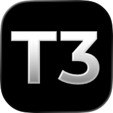

<p align="center">
  <a href="https://t3.codes">
    
  </a>
</p>

<h1 align="center">T3 Code</h1>

Works with your subscriptions and configured models on Claude Code, Codex, Cursor, Grok Build, OpenCode, Pi, Google Antigravity, and fx. If they're set up on your computer, T3 Science can control them.

<p align="center">
  <a href="https://t3.codes/download"><strong>Download</strong></a> ·
  <a href="https://apps.apple.com/us/app/t3-code-remote-claude-more/id6787819824">iOS</a> ·
  <a href="https://play.google.com/store/apps/details?id=com.t3tools.t3code">Android</a> ·
  <a href="https://app.t3.codes">Web</a> ·
  <a href="./docs/README.md">Docs</a> ·
  <a href="https://discord.gg/jn4EGJjrvv">Discord</a>
</p>

<p align="center">
  <a href="https://t3.codes">
    
  </a>
</p>

T3 Code runs the coding agents on your machine and gives them one fast interface. Start a thread at your desk, then approve the next step from your phone.

It works with Claude Code, Codex, Cursor, OpenCode, Grok Build, Antigravity, Kiro, Pi, Muse Code, fx, and any [ACP](./docs/user/providers-acp.md) agent. If an agent is set up on your computer, T3 Code can control it.

> [!WARNING]
> T3 Science currently supports Codex, Claude, Cursor, Grok Build, OpenCode, Pi, Antigravity, and fx. Install and authenticate at least one provider before use:
>
> - Codex: install [Codex CLI](https://developers.openai.com/codex/cli) and run `codex login`
> - Claude: install [Claude Code](https://claude.com/product/claude-code) and run `claude auth login`
> - Cursor: install [Cursor CLI](https://cursor.com/cli) and run `agent login`
> - Grok Build: install [Grok Build CLI](https://x.ai/cli) and run `grok login`
> - OpenCode: install [OpenCode](https://opencode.ai) and run `opencode auth login`
> - Antigravity: enable it in Settings, then use **Install Antigravity** and **Sign in with Google**. No CLI is required.
> - Pi: install [Pi](https://pi.dev) and configure a model by running `pi`
> - fx: install [fx](https://fx.sh) and run `fx login` on the machine running the T3 Code server ([setup guide](./docs/user/providers-fx.md))

### Command line

This installs the `t3` command. Run `t3` to start the server and open the web app.

```bash
curl -fsSL https://t3.codes/install.sh | sh
```

On Windows, in PowerShell:

```powershell
irm https://t3.codes/install.ps1 | iex
```

To try it once without an install, run `npx t3@latest`.

### Phone

Get the app from the [App Store](https://apps.apple.com/us/app/t3-code-remote-claude-more/id6787819824) or [Google Play](https://play.google.com/store/apps/details?id=com.t3tools.t3code). Then follow [remote access](./docs/user/remote-access.md) to connect it to your computer.

### Sign in to an agent

T3 Code needs one agent that is installed and signed in. For example, install [Claude Code](https://claude.com/product/claude-code) and run `claude auth login`, or install [Codex CLI](https://developers.openai.com/codex/cli) and run `codex login`.

[Provider setup](./docs/user/install.md#providers) has the steps for each agent. [Install T3 Code](./docs/user/install.md) covers nightly builds, AppImage, WSL, and NixOS.

## "Wait, what are you selling me?"

Nothing. We built T3 Code because we wanted the best possible development experience with agents. We were inspired by existing solutions like the Codex desktop app, Conductor, Claude Desktop and Cursor Glass, but none met our bar.

We wanted something performant, remote-ready, and truly open. If we ever go the wrong direction, we want you to have everything you need to fork and build the tool that you want.

## Documentation

- [Install and first run](./docs/user/install.md)
- [Remote access from a phone or another machine](./docs/user/remote-access.md)
- [Connect Claude Code, Codex, ChatGPT and other agents over MCP](./docs/user/outside-agents.md)
- [Keeping app and server in sync](./docs/user/updating.md)
- [Desktop tray and startup](./docs/user/desktop-tray.md)
- [Source control integrations](./docs/user/source-control.md)
- Multiple accounts: [Codex](./docs/user/providers-codex.md) · [Claude](./docs/user/providers-claude.md)
- [Run T3 Code as a background service](./docs/user/background-service.md)

[All docs](./docs/README.md) has the full list.

## Contributing

We have limited review capacity. Small, focused fixes are the most likely to be merged. Features need an approved discussion first.

- Read [CONTRIBUTING.md](./CONTRIBUTING.md) before you report a bug or open a pull request.
- Put feature requests in [Ideas](https://github.com/pingdotgg/t3code/discussions/categories/ideas).
- Build from source with the [development runbook](./docs/operations/development.md#first-checkout). The [architecture overview](./docs/internals/overview.md) explains how it works.
- Get help in [Discord](https://discord.gg/jn4EGJjrvv).

## License

[MIT](./LICENSE)
